# THEORY OF COMPUTER SCIENCE — SELF LEARNING ACTIVITY

## About the Activity

This repository contains the practical implementations completed as part of the **Theory of Computer Science Self-Learning Activity**.

The activity focuses on the study and implementation of different concepts of Automata Theory using JFLAP. It includes the construction of finite automata, conversion of automata, DFA minimization, regular expression conversion and Mealy Machine design.

Each practical includes its JFLAP implementation file, screenshots and a separate README containing its aim, problem statement and result.

---

## List of Practicals

### Practical 1 — Deterministic Finite Automaton (DFA)

**Problem Statement:** Design a DFA that accepts binary strings containing an even number of `1`s.

**Concepts:** DFA, states, transitions, initial state and final state.

**Implementation Screenshot:**

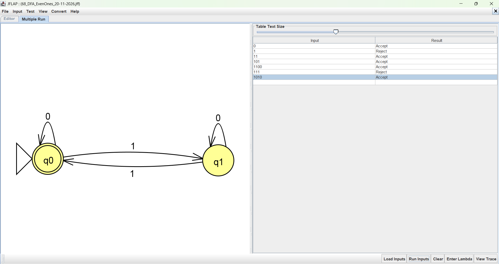

**JFLAP File:** [68_JeegnasaMakwana_DFA_EvenOnes_20-11-2026.jff](Practical_1_DFA/68_JeegnasaMakwana_DFA_EvenOnes_20-11-2026.jff)

**Practical Folder:** [Practical 1 — DFA](Practical_1_DFA/)

---

### Practical 2 — Non-Deterministic Finite Automaton (NFA)

**Problem Statement:** Design an NFA that accepts binary strings containing `01` as a substring.

**Concepts:** NFA, nondeterministic transitions and string acceptance.

**Implementation Screenshot:**

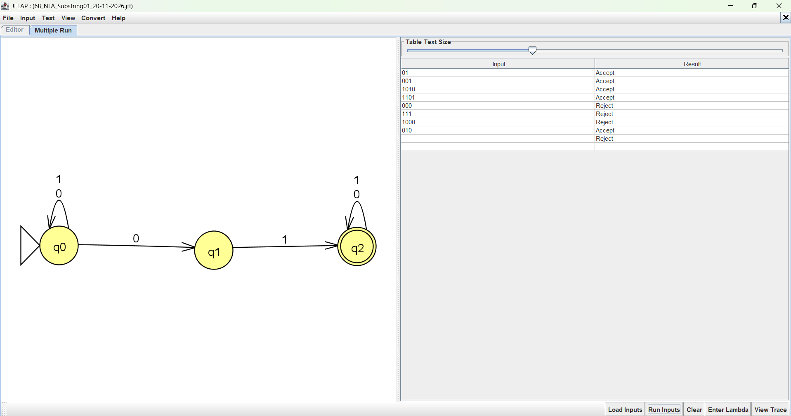

**JFLAP File:** [68_JeegnasaMakwana_NFA_Substring01_20-11-2026.jff](Practical_2_NFA/68_JeegnasaMakwana_NFA_Substring01_20-11-2026.jff)

**Practical Folder:** [Practical 2 — NFA](Practical_2_NFA/)

---

### Practical 3 — NFA to DFA Conversion

**Problem Statement:** Design an NFA that accepts binary strings containing `101` as a substring and convert it into an equivalent DFA.

**Concepts:** NFA, subset construction method and DFA conversion.

**NFA Implementation:**

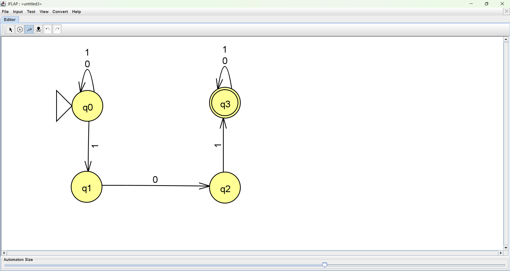

**Subset Construction:**

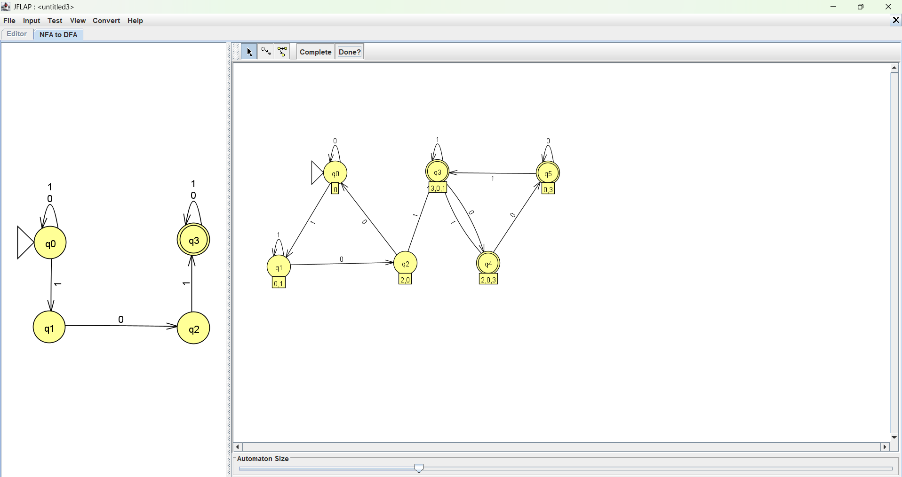

**Converted DFA:**

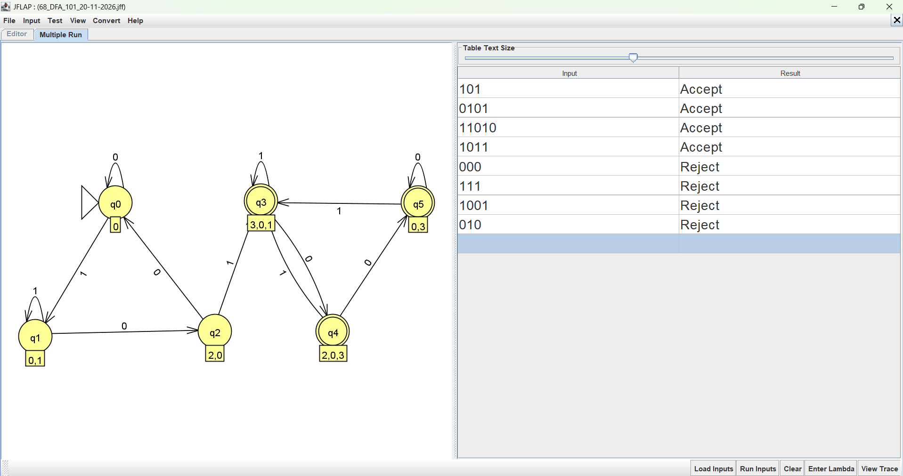

**JFLAP Files:**
- [Original NFA](Practical_3_NFA_to_DFA/68_JeegnasaMakwana_NFA_101_20-11-2026.jff)
- [Converted DFA](Practical_3_NFA_to_DFA/68_JeegnasaMakwana_DFA_101_20-11-2026.jff)

**Practical Folder:** [Practical 3 — NFA to DFA](Practical_3_NFA_to_DFA/)

---

### Practical 4 — DFA Minimization

**Problem Statement:** Design a DFA that accepts binary strings ending in `1` and minimize it by identifying equivalent states.

**Concepts:** Equivalent states, state partitioning and DFA minimization.

**Original DFA:**

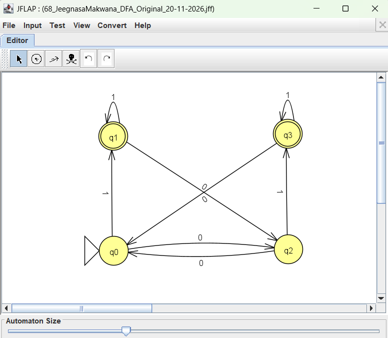

**State Partitioning:**

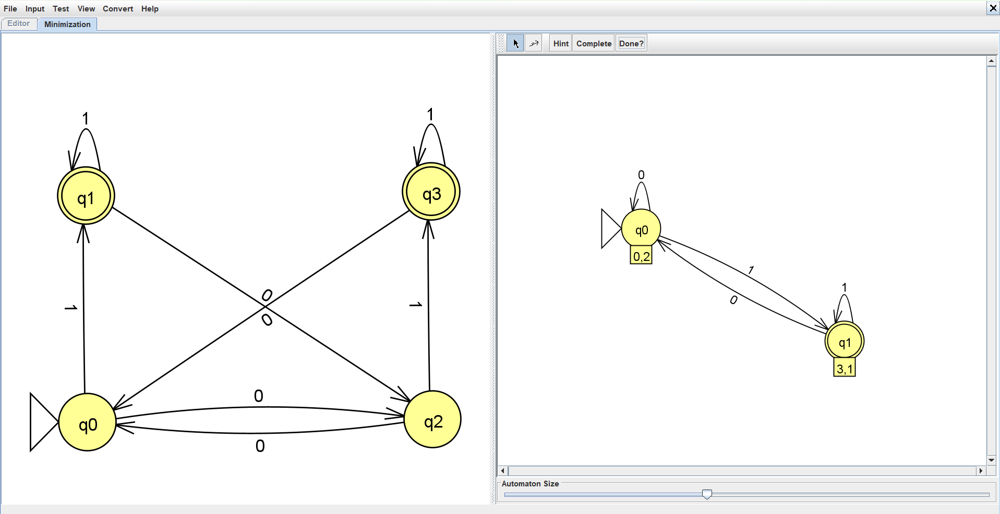

**Minimized DFA:**

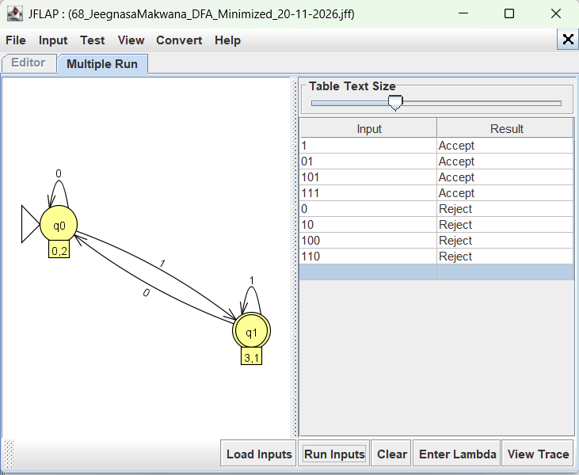

**JFLAP Files:**
- [Original DFA](Practical_4_DFA_Minimization/68_JeegnasaMakwana_DFA_Original_20-11-2026.jff)
- [Minimized DFA](Practical_4_DFA_Minimization/68_JeegnasaMakwana_DFA_Minimized_20-11-2026.jff)

**Practical Folder:** [Practical 4 — DFA Minimization](Practical_4_DFA_Minimization/)

---

### Practical 5 — Regular Expression to Finite Automaton

**Problem Statement:** Convert the regular expression `(a+b)*abb` into an equivalent finite automaton.

**Concepts:** Regular expressions, regular languages, NFA construction and DFA conversion.

**Regular Expression:**

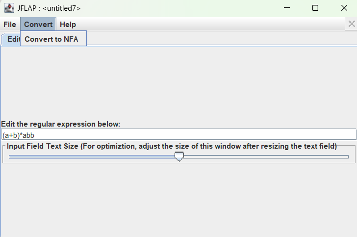

**NFA Conversion:**

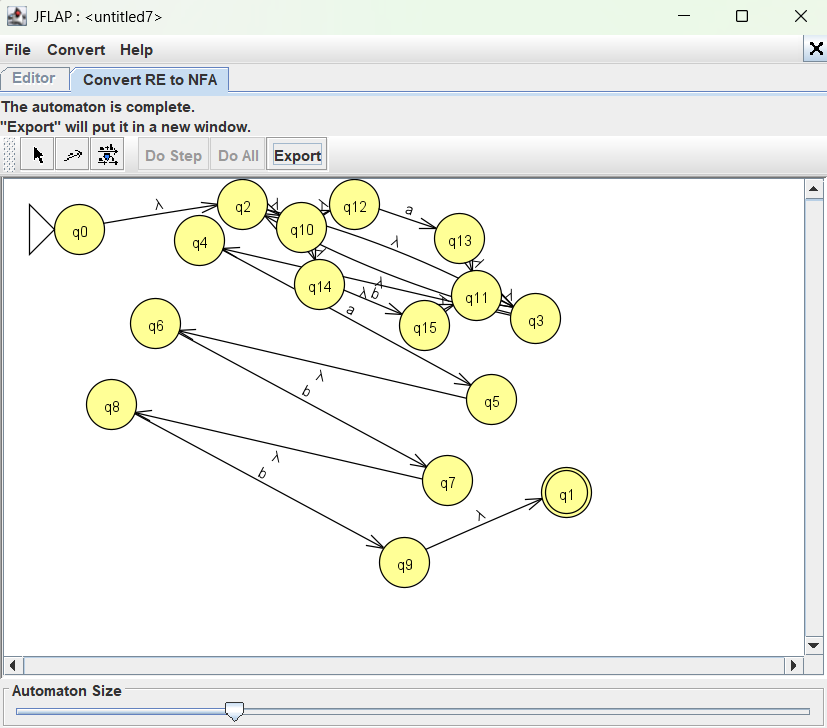

**Converted DFA:**

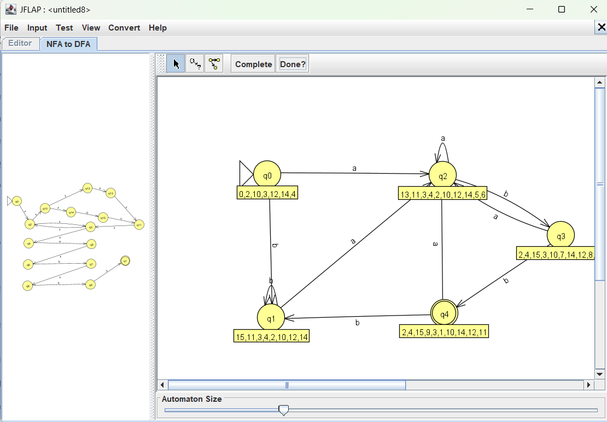

**Testing:**

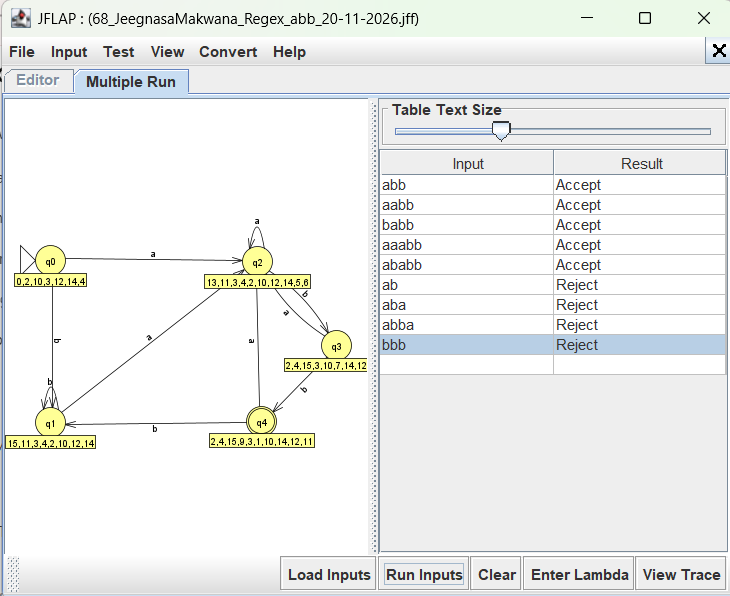

**JFLAP File:** [68_JeegnasaMakwana_Regex_abb_20-11-2026.jff](Practical_5_Regular_Expression/68_JeegnasaMakwana_Regex_abb_20-11-2026.jff)

**Practical Folder:** [Practical 5 — Regular Expression](Practical_5_Regular_Expression/)

---

### Practical 6 — Mealy Machine

**Problem Statement:** Design a Mealy Machine that detects the substring `01` in a binary input string and produces output `1` whenever the substring is detected.

**Concepts:** Mealy Machine, input-output transitions and state-based output generation.

**Implementation Screenshot:**

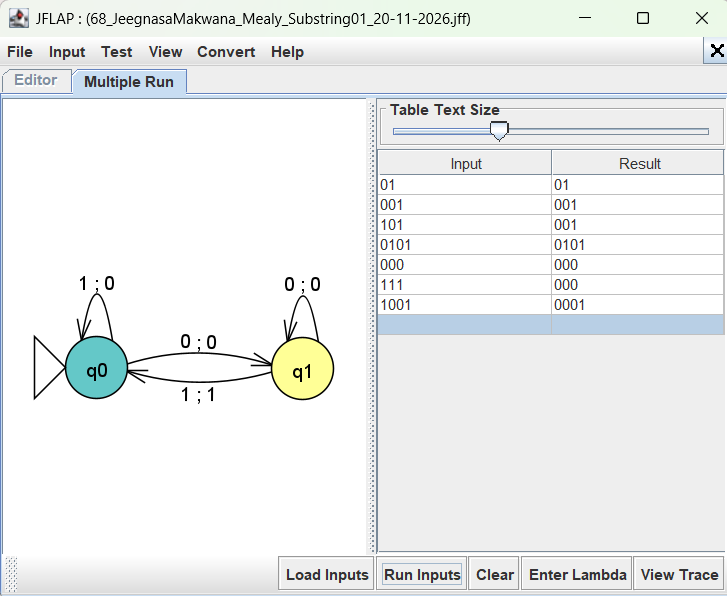

**JFLAP File:** [68_JeegnasaMakwana_Mealy_Substring01_20-11-2026.jff](Practical_6_Mealy_Machine/68_JeegnasaMakwana_Mealy_Substring01_20-11-2026.jff)

**Practical Folder:** [Practical 6 — Mealy Machine](Practical_6_Mealy_Machine/)

---

## Software Used

| Software | Purpose |
|---|---|
| JFLAP 7.1 | Designing, converting and testing automata |
| Java Runtime | Running JFLAP |
| GitHub | Storing practical files and documentation |
